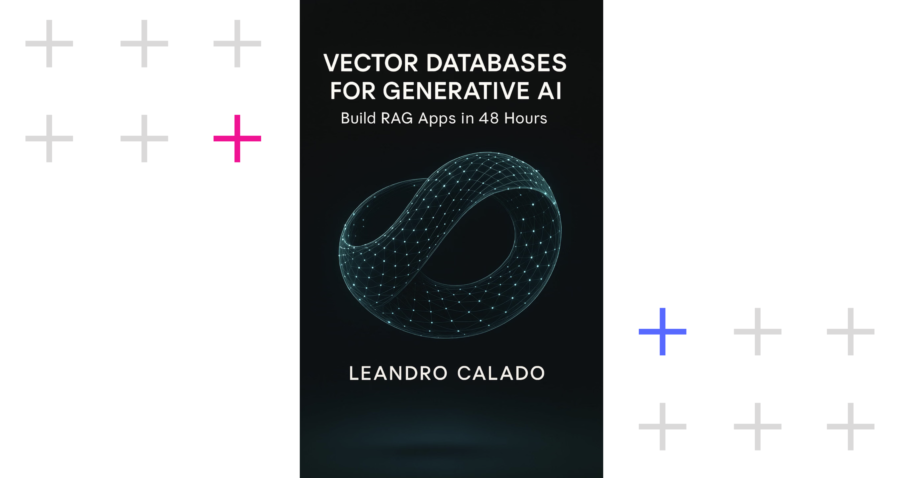
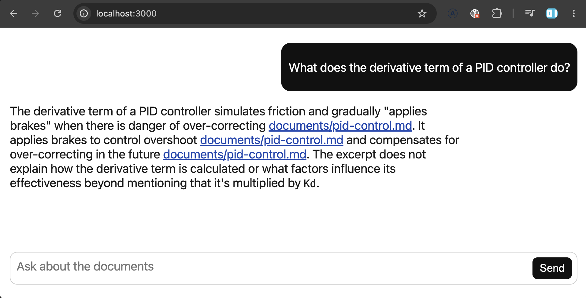
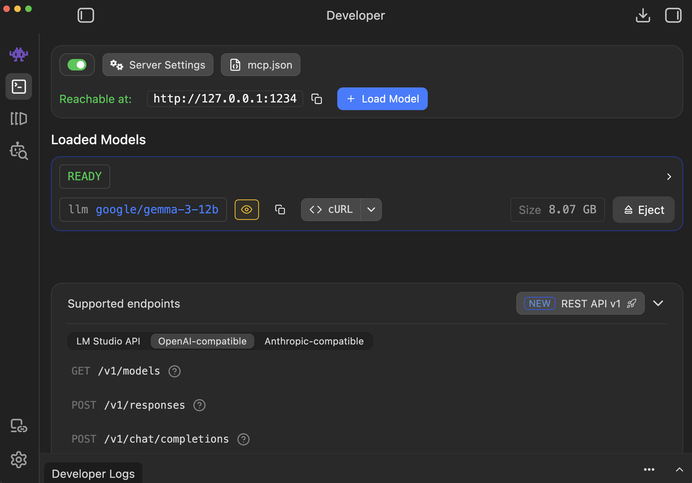
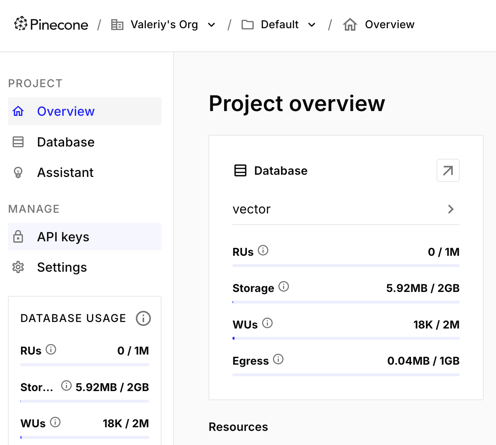
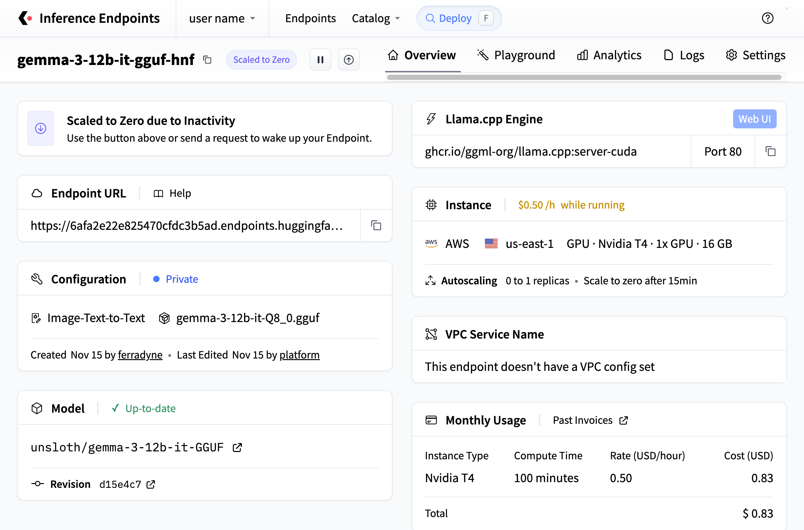
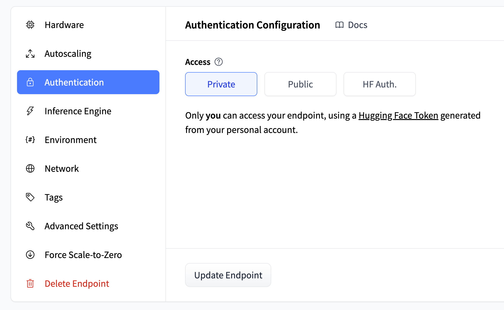
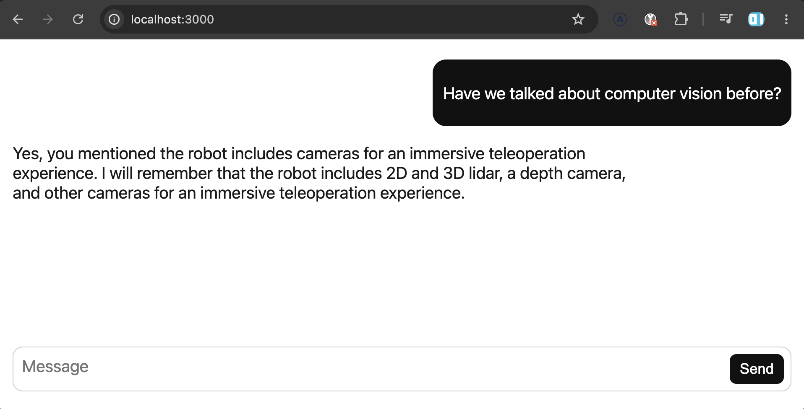
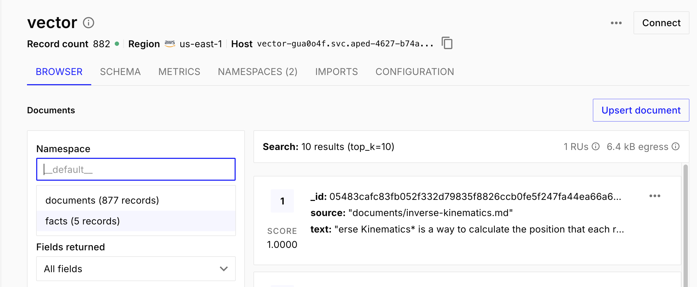
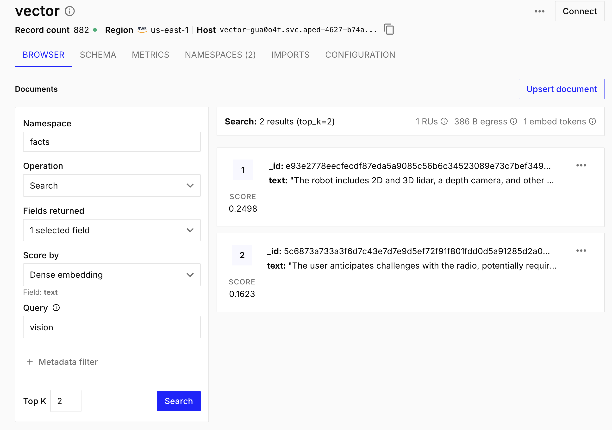

## overview

This tutorial will walk you through creating a search index for a collection of documents by using a vector database, and then using the [Retrieval Augmented Generation](https://www.ibm.com/think/topics/retrieval-augmented-generation) (RAG) technique to build a chat bot that relies on this database to answer questions.

While vector databases are useful on their own for indexing a collection of documents, combining this machine learning technique with generative AI provides agents with *long-term memory*, expanding their capabilities.

This hands-on tutorial is designed to help you integrate Retrieval Augmented Generation into your application as quickly as possible. You'll learn how to:

+ Search passages in documents based on semantic similarity
+ Build a chat bot that answers questions by searching documents
+ Build a chat bot that remembers facts from prior conversations

For a deeper introduction to this topic see [Vector Databases for Generative AI](https://www.amazon.com/Vector-Databases-Generative-AI-Build-ebook/dp/B0FH35DYNJ) by Leandro Calado:



## vector databases

Anyone implementing full-text search has to think about:

+ **Tokenizing**, or breaking the search criteria into separate search terms, which is typically done by splitting the text a user typed into a search box by white-space and punctuation characters.
+ **Sub-string matching**, so that a query term like "real" matches "realize". Sub-strings are called *n-grams* in vector database terminology.
+ **Stemming**, or transforming words into their most basic versions so that a query like "running" also matches documents containing "runs" or "run".
+ **Stop words**, or common words like "the", "and", "for" that must be filtered from the query to avoid matching every document.
+ **Similarity**, or matching by meaning rather than exact words ("run" - "sprint"), which is usually done by loading a thesaurus.
+ **Ranking**, or evaluating each maching document against the entire search criteria, usually based on how many of the terms match and their frequency in the document.

While a home-made search engine that uses tokenizing and sub-string matching is often sufficient for a personal blog or a hobby app, deployment at scale requires the intuitiveness of stemming, similarity matching, and ranking to meet the varied needs of many users.

These advanced features were only supported by enterprise search engines like [Elasticsearch](https://www.elastic.co/search-labs/blog/lexical-and-semantic-search-with-elasticsearch) until recently, requiring costly solutions like always-running virtual machines in the cloud.

The newer open-source vector databases like [Qdrant](https://github.com/qdrant/qdrant) and [Chroma](https://github.com/chroma-core/chroma) were built on the [Transformer](https://huggingface.co/learn/llm-course/chapter1/4) architecture by using [Embedding](https://www.ibm.com/think/topics/vector-embedding) layers for converting text into numbers that neural networks can process. They simply re-used the same mechanism for similarity search, and added common database operations like inserts and queries.

This technology spawned many affordable serverless solutions with free tiers and pricing based on usage, bringing advanced full-text search within the grasp of hobbyists and lean startups.

## selecting a database

A survey of popular vector databases reveals the following:

|Solution|Deployment|Storage|Usage Limits|
|-|-|-|-|
|[Chroma](https://www.trychroma.com/)|`Local`, `Serverless`|`1 GB`|**Low Cost**: `1T` transfer `$5` / month
|[Pinecone](https://www.pinecone.io/)|`Serverless`|`2 GB`|**Free**: `1M` read + `2M` writes / month|
|[Qdrant](https://qdrant.tech/cloud/)|`Local`, `VM`|`4 GB`|**Free**: `0.5` vCPU, unlimited requests|
|[Upstash](https://upstash.com/)|`Serverless`|`2 GB`|**Free**: `10K` queries + `10K` updates / day|
|[Milvus](https://milvus.io/)|`Local`, `Serverless`|`5 GB`|**Free**: `2.5M` vCUs / month, `5` collections|
|[Weaviate](https://weaviate.io/)|`Local`, `Serverless`|`10 GB`|**Free**: `100K` objects, `1 GB` RAM, `1` collection|

**Qdrant**, **Chroma**, **Milvus**, and **Weaviate** databases are open-source and can be operated locally or in the cloud while **Pinecone** and **Upstash** only run in the cloud and therefore require an API key.

**Pinecone** is a better choice for unattended deployments, such as a personal blog or an app. Unlike Qdrant which [shuts down inactive virtual machine clusters](https://qdrant.tech/documentation/cloud/create-cluster), Pinecone is *serverless* and spins up virtual machines on request.

## using a database

Indexing with a vector database involves:

+ *Chunking* and *encoding* a collection of documents
+ Creating a database and inserting the encoded vectors

The next few sections will demonstrate how to setup a *Chroma* database locally, use it for indexing documents, retrieve documents based on a search criteria, and orchestrate Retrieval Augmented Generation with a locally running model in [LM Studio](https://lmstudio.ai/).

The same steps are then repeated with a hosted *Pinecone* database to prepare you for deploying your solution to production.

> The Python code snippets in this tutorial are from the [vector](https://github.com/01binary/vector) companion repository included with this tutorial. The `main` branch contains the code for using *Chroma* database locally, and `pinecone` branch contains the code for using the serverless *Pinecone* database with an API key.

## chunking

Indexing a document requires feeding it through an encoder-only neural network implemented with the [Transformer architecture](https://huggingface.co/learn/llm-course/chapter1/4).

A very small model is typically used for this purpose, such as the [all-MiniLM-L6-v2](https://huggingface.co/sentence-transformers/all-MiniLM-L6-v2). Unlike a generative LLM, this model produces a 384-dimensional embedding vector instead of text.

Since `Transformer`-based neural networks have a limited context window and cannot process arbitrarily large documents, the documents are split into bite-sized passages called *chunks*.

Chunking also aids retrieval, allowing us to return the *matching passage* instead of the entire document, which is a lot friendlier for the users.

The simplest chunking method is splitting each document into equal size chunks with some overlap, which helps when the split happens mid-sentence:

```python
# Split a document into chunks
def chunk_text(text, size=500, overlap=100):
    step = size - overlap

    for start in range(0, len(text), step):
        chunk = text[start:start + size]

        if chunk.strip():
            yield chunk
```

## embedding

The chunks are then sent to the *embedding model* to transform text into embedding vectors. In this tutorial we use [all-MiniLM-L6-v2](https://huggingface.co/sentence-transformers/all-MiniLM-L6-v2):

```python
# Load embedding model
from sentence_transformers import SentenceTransformer
model = SentenceTransformer("all-MiniLM-L6-v2")
```

The model is automatically loaded by the [SentenceTransformer](https://sbert.net/) package:

> Sentence Transformers (a.k.a. SBERT) is the go-to Python module for using and training state-of-the-art embedding and reranker models and unlocks a wide range of applications, including semantic search, semantic textual similarity, and paraphrase mining.

The [indexing script](https://github.com/01binary/vector/blob/main/index.py) included in the [companion repository](https://github.com/01binary/vector) loads all markdown files in the [/documents](https://github.com/01binary/vector/tree/main/documents) folder, splits them into chunks, and encodes each chunk into an array of vectors:

```python
# Chunk all markdown documents
from pathlib import Path

for path in sorted(Path("documents").rglob("*.md")):
    text = path.read_text(encoding="utf-8")

    chunks = list(chunk_text(text))

    if not chunks:
        continue

    # Convert chunks to vectors
    vectors = model.encode(chunks).tolist()
```

## indexing

All that remains is to insert a list of vectors for each chunk into the database, and record some *metadata* about each chunk, such as the name of the document where its content originated.

The Chroma database is created in the same folder as the script by using the [chromadb](https://pypi.org/project/chromadb/) Python package:

```python
# Create index database and collection
import chromadb

db = chromadb.PersistentClient(path="./database")
collection = db.get_or_create_collection("documents")
```

The encoded array of vectors for each chunk is inserted into the database:

```python
# Store vectors and source text
collection.upsert(
    ids=[f"{path}:{i}" for i in range(len(chunks))],
    embeddings=vectors,
    documents=chunks,
    metadatas=[{"source": str(path)} for _ in chunks],
)
```

After following the instructions in [readme](https://github.com/01binary/vector/blob/main/README.md) for the companion repository, you will see the Chroma database created in the `/database` folder. This includes a `.sqlite` database that can be opened in a tool like [DBeaver](https://dbeaver.io/).

## retrieval

The [retrieval script](https://github.com/01binary/vector/blob/main/search.py) included in the [companion repository](https://github.com/01binary/vector) queries the same Chroma database created in the previous step:

```python
# Text to search for
query = "psychology"

# Load vector database
import chromadb
db = chromadb.PersistentClient(path="./database")
collection = db.get_or_create_collection("documents")

# Load embedding model
from sentence_transformers import SentenceTransformer
model = SentenceTransformer("all-MiniLM-L6-v2")

# Encode query text into vectors
vectors = model.encode(query).tolist()

# Find matching vectors
results = collection.query(
    query_embeddings=[vectors],
    n_results=5,
    include=["documents", "metadatas"],
)
```

The results are then printed to the output. This script can be piped into a file to conveniently view the results as markdown:

```bash
python ./search.py > results.md
```

## going serverless

Using a local database like *Chroma* lets you experience vector databases first-hand, without hiding too many implementation details behind a cloud service.

Indexing with a cloud service like *Pinecone* works much the same way. Cloud providers often integrate other related operations like embedding directly into their service, which lets us skip this step.

The [indexing script](https://github.com/01binary/vector/blob/pinecone/index.py) included on [pinecone](https://github.com/01binary/vector/tree/pinecone) branch of the [companion repository](https://github.com/01binary/vector) looks very much like the Chroma script, but uses the Pinecone SDK, with API key set as an environment variable:

```bash
export PINECONE_API_KEY="your-api-key"
```

The chunks are then uploaded to Pinecone in the same indexing loop:

```python
# Index documents with Pinecone
from hashlib import sha256
from pathlib import Path

# For each document
for path in sorted(Path("documents").rglob("*.md")):
    # Split into chunks
    chunks = list(chunk_text(path.read_text(encoding="utf-8")))

    if not chunks:
        continue

    # Calculate checksum
    path_id = sha256(str(path).encode("utf-8")).hexdigest()

    # Upload to Pinecone
    result = index.documents.batch_upsert(
        namespace="documents",
        documents=[
            {"_id": f"{path_id}:{i}", "text": chunk, "source": str(path)}
            for i, chunk in enumerate(chunks)
        ]
    )
```

## orchestration

Once the documents are indexed, all that remains is orchestrating the user's interaction with the chat LLM.

This involves transforming their question into embedding vectors, querying the database, and injecting the search results into the prompt.

The [Retrieval Augmented Generation script](https://github.com/01binary/vector/blob/main/rag.py) in the [companion repository](https://github.com/01binary/vector) talks to a local LLM running in [LM Studio](https://lmstudio.ai/), providing a [System Prompt](https://github.com/01binary/vector/blob/main/SYSTEM_PROMPT.md) and injecting the retrieved chunks into the User Prompt:

```python
# Connect to Chroma database
import chromadb

db = chromadb.PersistentClient(path="./database")
collection = db.get_collection("documents")

# Load embedding model
from sentence_transformers import SentenceTransformer
embedding_model = SentenceTransformer("all-MiniLM-L6-v2")

# Load chat model
from openai import OpenAI
chat_model = OpenAI(
  base_url="http://127.0.0.1:1234/v1",
  api_key="lm-studio"
)

# Input
question = input("Question or topic: ").strip()

# Embed
vector = embedding_model.encode(question).tolist()

# Retrieve
results = collection.query(
  query_embeddings=[vector],
  n_results=3,
  include=["documents", "metadatas"]
)

# Assemble
context = "\n\n".join(
  f"Source: {metadata['source']}\n{text}"

  for text, metadata in zip(
    results["documents"][0],
    results["metadatas"][0],
  )
)

# Load system prompt
from pathlib import Path
system_prompt = Path(__file__).with_name("SYSTEM_PROMPT.md").read_text(encoding="utf-8").strip()

# Output
response = chat_model.chat.completions.create(
    model="google/gemma-3-12b",
    messages=[
        {
            "role": "system",
            "content": system_prompt,
        },
        {
            "role": "user",
            "content": (
                f"Question or topic: {question}\n\n"
                f"Document excerpts:\n{context}"
            ),
        },
    ],
)

print(response.choices[0].message.content)
```

This is simple to update with URL and API key of a cloud-hosted AI model, using a provider like Hugging Face Inference Endpoints, covered in the [previous tutorial](./ai-integration.md#production) on this site.

The [same script](https://github.com/01binary/vector/blob/pinecone/rag.py) on the `pinecone` branch of the companion repository only differs in the simplicity resulting from using an integrated online service:

```python
# Load chat model
from openai import OpenAI
chat_model = OpenAI(
  base_url="http://127.0.0.1:1234/v1",
  api_key="lm-studio"
)

# Input
question = input("Question or topic: ").strip()

# Retrieve
from pinecone import EmbedQuery, Pinecone

results = Pinecone().index("vector").documents.search(
  namespace="documents",
  top_k=3,
  score_by=[EmbedQuery(field="text", query=question)],
  include_fields=["text", "source"],
)

# Assemble
context = "\n\n".join(
  f"Source: {match.source}\n{match.text}" for match in results.matches
)

# Load system prompt
from pathlib import Path
system_prompt = Path(__file__).with_name("SYSTEM_PROMPT.md").read_text(encoding="utf-8").strip()

# Output
response = chat_model.chat.completions.create(
    model="google/gemma-3-12b",
    messages=[
        {
            "role": "system",
            "content": system_prompt,
        },
        {
            "role": "user",
            "content": (
                f"Question or topic: {question}\n\n"
                f"Document excerpts:\n{context}"
            ),
        },
    ],
)

print(response.choices[0].message.content)
```

## rag application

Now that we examined the low-level details of how Retrieval Augmented Generation works by *orchestrating* the user's interaction with a chat model and injecting relevant snippets from the matching documents into the prompt, we can build a complete RAG application.

On the [pinecone](https://github.com/01binary/vector/tree/pinecone) branch of the [companion repository](https://github.com/01binary/vector), there is a React.js application that displays a chat box created by using the [@assistant-ui/react](https://www.npmjs.com/package/@assistant-ui/react) Node.js package ([assistant-ui.com](https://www.assistant-ui.com/)):



This lets you type in a question and replies with excerpts from the matching documents, allowing you to open any of the documents in a new window.

> In this demonstration, the vectors are upserted at *build-time* and the application makes use of information already in the database at *run-time*. The next demonstration will feature inserting at run-time as well.

The Pinecone API key, as well as the URL and API key of the AI model are configurable by using environment variables in `.env.local` which can be created by copying [.env.example](https://github.com/01binary/vector/blob/pinecone/.env.example):

```bash
PINECONE_API_KEY=
OPENAI_BASE_URL=http://127.0.0.1:1234/v1
OPENAI_API_KEY=lm-studio
OPENAI_MODEL=google/gemma-3-12b
```

To test locally with a locally running AI in [LM Studio](https://lmstudio.ai/), update the `OPENAI_MODEL` to the identifier of your model:



The only other setting is your Pinecone API key which can be found on the dashboard under API Keys:



To test with an AI model running in the cloud, plug in the URL and API key of the model's OpenAPI-compatible endpoint:



See [production deployment](./ai-integration.md#production) section of the previous article for a primer on how to run serverless AI models in the cloud:



## memory application

A basic RAG application is like a talking book: it can help you look up relevant facts and cite sources. However, the most powerful use of RAG is remembering key facts from earlier conversations and using them to enrich the current conversation context.

On the [readwrite](https://github.com/01binary/vector/tree/readwrite) branch of the [companion repository](https://github.com/01binary/vector), the chat bot is enhanced with the ability to write facts to the vector database, which lets it remember facts and instructions from all previous conversations.

In addition, the [LangGraph](https://info.langchain.com/langsmith/for-langgraph) library is used to automate the task of orchestrating AI agents by building a state machine-like workflow which supports both retrieval and [tool calls](./ai-integration.md#tool-calling).

This application uses exactly the same configuration as the previous demonstration, except there is no longer an indexing step since the indexing happens in real-time while chatting with the agent.

The [frontend](https://github.com/01binary/vector/tree/readwrite/app) remains the same, only simplified to remove the ability to open markdown documents. The documents themselves have been removed as well.

The new [facts.js](https://github.com/01binary/vector/blob/readwrite/lib/facts.js) module is responsible for saving and retrieving facts from the user's conversations with the agent is called.

It initializes the Pinecone client in the constructor, using the same `vector` database but a different *namespace* (essentially another database table) called `facts`:

```javascript
import { createHash } from "node:crypto";
import { Pinecone } from "@pinecone-database/pinecone";

const pinecone = new Pinecone();
let ready;

function facts() {
  ready ??= pinecone.indexes
    .create({
      name: "vector",
      schema: {
        fields: {
          text: { type: "string", embed: { model: "text-embedding-3-small" } },
        },
      },
      suppressConflicts: true,
      waitUntilReady: true,
    })
    .catch((error) => {
      ready = undefined;
      throw error;
    });

  return ready.then(() =>
    pinecone.index({ name: "vector", namespace: "facts" }),
  );
}
```

The `searchFacts` function is used to vectorize a search query and return the top `5` matches:

```javascript
export async function searchFacts(query, topK = 5) {
  const index = await facts();
  const results = await index.documents.search({
    topK,
    scoreBy: [{ type: "embed", field: "text", query }],
    includeFields: ["text", "savedAt"],
  });
  return results.matches;
}
```

The `saveFact` function takes care of inserting new facts into the database with an identifier generated by hashing the fact text:

```javascript
export async function saveFact(text) {
  const fact = text.trim();
  const id = createHash("sha256").update(fact.toLowerCase()).digest("hex");
  const index = await facts();
  await index.documents.upsert({
    documents: [{ _id: id, text: fact, savedAt: new Date().toISOString() }],
  });
  return fact;
}
```

Finally, the entire workflow is orchestrated in just a few lines of code in [graph.js](https://github.com/01binary/vector/blob/readwrite/lib/graph.js) module. First we define a tool call used to store facts:

```javascript
const saveFactTool = tool(
  async ({ fact }) => `Saved: ${await saveFact(fact)}`,
  {
    name: "save_fact",
    description:
      "Save one durable fact the user shared so it can be recalled in later conversations.",
    schema: z.object({
      fact: z
        .string()
        .describe(
          "One self-contained sentence in the third person, such as: The user's dog is named Rex.",
        ),
    }),
  },
);
```

An LLM client that supports the OpenAI-Compatible REST API is created with `ChatOpenAI` class from *LangGraph*, and the tool is advertised to the agent. The same environment variables are used as in the previous demonstration to configure the REST API endpoint URL and API key:

```javascript
const tools = [saveFactTool];

const chatModel = new ChatOpenAI({
  model: process.env.OPENAI_MODEL,
  apiKey: process.env.OPENAI_API_KEY,
  configuration: { baseURL: process.env.OPENAI_BASE_URL },
}).bindTools(tools);
```

The state of the state machine that runs the workflow is created by using the `Annotation` class from *LangGraph*:

```javascript
const State = Annotation.Root({
  ...MessagesAnnotation.spec,
  facts: Annotation(),
});
```

The functions called for each step of the workflow are defined next:

```javascript
// Retrieve facts matching the last message from the user
async function retrieve({ messages }) {
  const matches = await searchFacts(messages.at(-1).text);

  const facts = matches
    .map((match) => `- ${match.text} (saved ${match.savedAt.slice(0, 10)})`)
    .join("\n");

  return { facts: facts || "(none)" };
}

// Call the agent providing system prompt and retrieved facts
async function agent({ messages, facts }) {
  const system = new SystemMessage(
    `${systemPrompt}\n\nKnown facts:\n${facts}\n\nThe conversation with the user starts now.`,
  );
  return { messages: [await chatModel.invoke([system, ...messages])] };
}

// Wait for completion of any tool calls
function afterTools({ messages }) {
  const toolCall = messages.findLast((message) => message.tool_calls?.length);
  return toolCall.text.trim() ? END : "agent";
}
```

The system prompt referenced above is loaded from [SYSTEM_PROMPT.md](https://github.com/01binary/vector/blob/readwrite/SYSTEM_PROMPT.md) at the root of the repository. The prompt was modified for this demo.

```javascript
const systemPrompt = readFileSync(
  path.join(process.cwd(), "SYSTEM_PROMPT.md"),
  "utf8",
).trim();
```

Finally, the *LangGraph* library is used to orchestrate the entire loop between the user and the LLM.

```javascript
export const graph = new StateGraph(State)
  //
  // Add Nodes
  //

  // Retrieving facts matching user prompt
  .addNode("retrieve", retrieve)

  // Sending system prompt, facts, and user prompt to the agent
  .addNode("agent", agent)

  // Handling tool calls requested by the agent
  .addNode("tools", new ToolNode(tools))

  //
  // Connect Edges
  //

  // Always retrieve facts matching user prompt
  .addEdge(START, "retrieve")

  // Always send facts to the agent
  // along with system and user prompts
  .addEdge("retrieve", "agent")

  // Call tools if agent asks for it
  .addConditionalEdges("agent", toolsCondition)

  // Continue only after tool calls are finished
  .addConditionalEdges("tools", afterTools)

  //
  // Done!
  //
  .compile();
```

Run the application and talk to the bot about what you're doing, then restart the application and ask it about something from a prior conversation:



If you log in to Pinecone and open the `vector` database, you can now pick the `facts` namespace, allowing you to debug the agent's memory by looking at stored facts:



When *Fields returned* is set to `text` and *Score by* to `Dense Embedding`, you can enter any term into the *Query* field and watch the relevant facts retrieved:



## closing

In this tutorial we've looked at using modern, open-source vector databases to easily replicate what used to be hours of work in setting up a complex deployment like Elasticsearch, or using advanced algorithms like [BM25](https://www.elastic.co/blog/practical-bm25-part-2-the-bm25-algorithm-and-its-variables) to roll your own full-text search.

This sample code in this tutorial can be run on most Mac and Windows computers using a local vector database called *Chroma*.

For practical deployment in production, the code can be easily adopted to *Pinecone*, an online serverless vector database with a generous free tier that doesn't ask for a credit card, making it a good choice for prototypes and personal projects.
